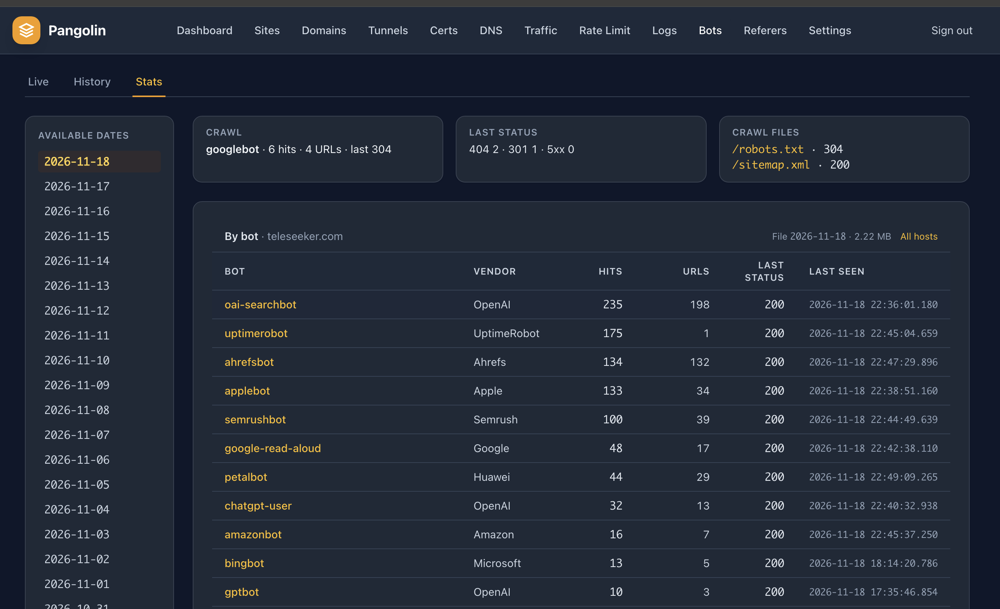

# 🦔 Pangolin — an SEO-oriented, self-hosted CDN software

[中文](./README.md)

A self-hosted multi-site gateway for site operators and SEO people — a reverse proxy gateway that runs on your own machine, whose classic use is sitting behind a CDN such as Cloudflare and spreading the traffic across the several sites you host on that machine.

Pangolin terminates HTTP/HTTPS traffic and then distributes it by hostname across the sites on that machine; it can also stand on its own at the front, with no CDN in front of it at all. Before it forwards anything, it answers the three questions only an operator really has: whether this visitor is a genuine search-engine crawler, whether this source IP has already saturated the site, and which external site this visit came from. Every decision, every limit and every record stays on that machine — nothing leaves your infrastructure.

## Are you running into these too?

- **"Did Googlebot or Baiduspider crawl the site last night, and which pages did they get?"** Google Search Console and Baidu's Search Resource Platform each lag by a day or two, and each only sees its own engine; Cloudflare gives you no per-request crawler log. The only way to get today's crawler log is to grep your own access.log by hand, or to pay for a tool that parses nginx logs after the fact.
- **"I want rate limiting against CC attacks — how do I do that without blocking Googlebot and losing my rankings?"** A WAF or a JS challenge that stops Baiduspider and costs you indexed pages is a well-known accident in the SEO world: the harder the defence, the faster the rankings fall.
- **"I run multiple sites on one server, but the CDN can only point every domain at one IP — how do I do multi-site?"** The internal routing and the certificates are yours to maintain, in a pile of hand-written nginx server blocks.
- **"Once the origin IP leaks, anybody can bypass the CDN and hit my origin directly."** Machine rooms and scanners collect origin addresses all day; once one leaks, the CDN layer in front of you is worth nothing.

## What this is

Pangolin is a reverse proxy gateway: it terminates HTTP/HTTPS and distributes the requests across the sites on that machine by hostname. The classic deployment is a **second-level gateway** — the visitor hits Cloudflare or another CDN first, then the gateway, then the individual sites; with no CDN in front, it simply stands at the front on its own.

```
Visitor → Cloudflare / any CDN → Pangolin → site A / site B / site C
```

It is not another proxy that only forwards requests: before forwarding, it recognises the crawler, does the rate-limit arithmetic and notes where the referral came from. Of the three record channels, the crawler log and the referral log rotate daily at UTC into JSONL files that sit on your own disk.

## The four capabilities

### Crawler log: who came, and which page they read

**The pain:** Google Search Console and Baidu's Search Resource Platform each lag by a day or two, and each only sees its own engine; Cloudflare gives no per-request crawler log.

**The answer:** the gateway does its own **log file analysis** — every line lands in a `bot-YYYY-MM-DD.jsonl` file, the `/logs/bots` page of the admin UI pushes it in **real-time**, and each row carries the host, the path, the status code, the User-Agent and the name of the crawler that matched. Only crawlers that pass the identity check reach that log.



### Protection can be brutal, but it never misfires on a verified bot

**The pain:** you want a rate limit against CC attacks, but you are afraid of blocking the real spiders and losing your rankings.

**The answer:** a crawler has to pass a double check — the marker in the User-Agent matches a known crawler byte for byte **and** the client IP sits inside the address range the vendor publishes; both have to hold. A forged User-Agent alone is treated as an ordinary visitor and still counts against the limit. A **verified bot** does not count against the site's **rate limit** by default, and you can name a specific crawler to put it back under the limit without letting forged traffic through.

### Referral attribution: the traffic your external links bring, held by you

**The pain:** you want to know which external links send you traffic, but the backend only ever sees the `Referer` header — and crawlers and plain API clients never execute JavaScript.

**The answer:** the gateway collects **referral** attribution server-side, so crawlers and API clients count too, with no JS beacon involved; the result is grouped per site and written as `referer-YYYY-MM-DD.jsonl`, a file you own — `jq` and DuckDB read it directly.

### Several sites on one machine, certificates issued for you

**The pain:** one server runs several sites, the CDN can only point at one IP, and a leaked origin IP lets anybody bypass the CDN and hit the origin.

**The answer:** the traffic is distributed to the sites on that machine by hostname, and the **certificate** for each domain is issued and renewed by the gateway (one switch per domain); the **origin guard** keeps a per-site allowlist (the ranges you entered by hand, unioned with the ranges the site's front CDN publishes) and answers `403` to any request whose TCP peer address is not on it.

## Running in 30 seconds

One command installs the gateway (Linux x86_64 / arm64, macOS Apple Silicon / Intel):

```bash
curl -fsSL https://github.com/cnlangzi/pangolin/releases/latest/download/install.sh | sudo sh
```

When it finishes, the machine is a gateway that can face the internet:

- the binaries are in `/usr/local/pangolin` (`0755`), the configuration next to them (`0600`);
- on Linux `pangolin-ngx` runs as a systemd service, listening on `80` / `443`;
- the admin UI is at `http://<host>:9081/`, with the default user `admin` and the password `pangolin`.

The script works out the platform, downloads the matching release archive, verifies it against the release's `SHA256SUMS.txt`, rewrites the configuration for production (ports, admin password, ACME address, log level), creates the `pangolin` system user, installs the systemd units and starts the gateway. **A failed checksum leaves nothing behind** — the install directory is not touched until every download has been verified.

**Two things have to change afterwards**: the admin password (the shipped `pangolin` is public) and the admin interface's listen address (`0.0.0.0:9081` exposes it to the whole network). The full checklist is in [getting-started.en-US.md](./docs/getting-started.en-US.md).

Prefer to install by hand (or you are on Windows with the `.zip`)? `v0.3.0` below is an example; substitute the version you want:

```bash
VERSION=v0.3.0
curl -LO "https://github.com/cnlangzi/pangolin/releases/download/${VERSION}/pangolin_${VERSION}_linux_amd64.tar.gz"
curl -LO "https://github.com/cnlangzi/pangolin/releases/download/${VERSION}/SHA256SUMS.txt"
sha256sum -c SHA256SUMS.txt
sudo mkdir -p /usr/local/pangolin && sudo tar -xzf "pangolin_${VERSION}_linux_amd64.tar.gz" -C /usr/local/pangolin
```

Unpack, `cd /usr/local/pangolin && ./pangolin-ngx`, and the admin UI is at `http://127.0.0.1:9081/` (the default user and password are both `admin`). The `ngx.yml` in the archive holds **development defaults** — the ports, the admin password, the paths and the token all have to change before production. The full installation procedure and the go-live checklist are in [getting-started.en-US.md](./docs/getting-started.en-US.md).

Prefer to build it yourself? You need Rust 1.96; clone the repository and run `make build` (which also builds the admin UI's CSS).

## How it differs from nginx and Cloudflare

| Capability | nginx | Cloudflare | Pangolin |
| --- | --- | --- | --- |
| **Crawler log detail** | None (you parse the logs yourself) | The free tier only gives you aggregates | Written per request, visible in the admin UI in real-time |
| **Rate limiting that never misfires on a verified bot** | No crawler identification | "Verified Bot" is only a rule field; WAFs blocking crawlers is a common accident | User-Agent plus the vendor's published ranges; a crawler that passes does not count against the limit |
| **Server-side referral attribution** | None (the `Referer` header is only passed through) | It has one (the `Referer` dimension of Web Analytics), but it rides on a JS beacon | Collected at the gateway — crawlers and API clients count the same |

The full citation matrix (every row points at the competitor's own documentation and carries the date it was last checked) is in [comparison.en-US.md](./docs/comparison.en-US.md).

## Current limitations

- The `cache` configuration section is parsed, but the gateway implements no response cache at all — do not expect anything from it.
- There is no Prometheus endpoint; the metrics are only visible in the admin UI.
- The SQLite database path is fixed to `pangolin.db` in the working directory and cannot be configured.
- The release pipeline builds `linux/amd64` only; the other architectures have to be compiled from source.
- The intranet tunnel (`pangolin-tun`) is a development aid, not the headline feature — its WebSocket/TCP fallback is unencrypted (the bearer token crosses the network in the clear), and a `file://` backend cannot be reached through it (`501`).

## Documentation

Every document is listed in [`docs/README.md`](./docs/README.md). The thirteen tables of the database are described field by field in [the schema](./docs/schema.md), and the migration mechanism and version history are in [database migrations](./docs/migrations.md).

## Development

Requires **Rust 1.96**. Run `make lint` before committing; read [`AGENTS.md`](./AGENTS.md) before contributing — it says what has to run before a commit, why migration files must not be edited and how the admin UI assets are built.
