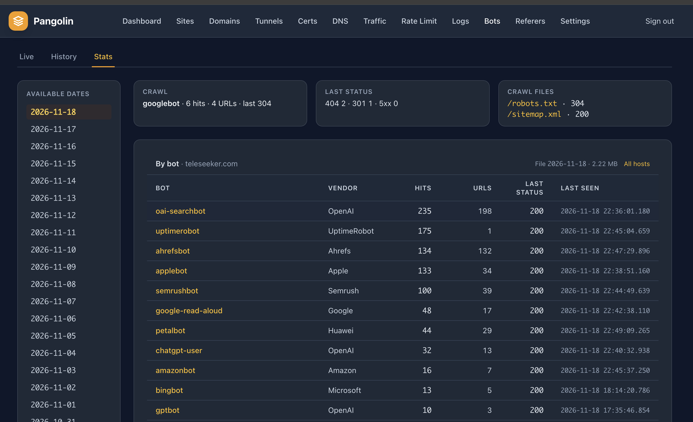

# 🦔 Pangolin — 面向 SEO 的多站点自托管网关

[English](./README.en-US.md)

为站点运营者和 SEO 从业者打造的自托管多站点网关 —— 一个运行在你自己机器上的反向代理。典型用法是放在 Cloudflare 等 CDN 后面，按域名把流量分发到本机的多个站点。

Pangolin 在本机终结 HTTP/HTTPS，再按域名分发到各个站点；不挂 CDN 时，它也可以独立顶在最前面。转发之前，它会先回答三个只有运营者才关心的问题：来访的是不是真正的搜索引擎爬虫？这个来源 IP 是不是已经把本站打满了？这次访问是从哪个外部网站过来的？所有判断、限速和记录都发生在这台机器上，数据不出你的基础设施。

## 你是不是也遇到过这些问题？

- **「Googlebot 和百度蜘蛛昨晚来过没有？抓了哪几页、各拿到什么状态码？」** Google Search Console 和百度站长平台的数据要滞后一两天，还各只看得到自家引擎；Cloudflare 不给逐请求的爬虫明细。想拿到今天的爬虫日志，要么手工 `grep` 自己的 access.log，要么花钱买工具做事后解析。
- **「我想开限速防 CC，又怕误伤真蜘蛛、把收录掉光。」** WAF 或 JS 挑战误拦 Baiduspider 导致收录暴跌，是站长圈众所周知的事故：防护越狠，收录掉得越快。
- **「一台服务器跑好几个站，CDN 又只能把域名指到一个 IP，多站点怎么搞？」** 剩下的域名分发和证书，只能靠自己维护一堆 nginx server 块。
- **「源站 IP 一旦泄露，谁都能绕过 CDN 直接打源站。」** 机房和扫描器天天在收集源站地址；一旦泄露，CDN 那层防护就形同虚设。

## 这是什么

Pangolin 是一个反向代理网关：终结 HTTP/HTTPS，按域名把请求分发到本机各站点。典型部署形态是**二级网关** —— 访客先过 Cloudflare 或其他 CDN，再到网关，最后到各个站点；不挂 CDN 时，它就独立站在最前面。

```
访客 → Cloudflare / 任意 CDN → Pangolin → 站点 A / 站点 B / 站点 C
```

它不是一个只会转发的代理：转发之前，先认出爬虫、算好限速、记下引荐来源。三条记录通道里，爬虫日志和引荐日志按 UTC 日期每日轮转，落成 JSONL 文件，存在你自己的磁盘上。

## 四个能力

### 爬虫日志：谁来过、看了哪一页

**痛点：** Google Search Console 和百度站长平台的数据各滞后一两天，还只看得到自家引擎；Cloudflare 没有逐请求的爬虫明细。

**答案：** 网关自己做**爬虫日志分析** —— 每条记录落进 `bot-YYYY-MM-DD.jsonl`，管理界面的 `/logs/bots` 页面**实时**推送，带 host、路径、状态码、User-Agent 和命中的爬虫名。只有通过身份验证的爬虫才会进这份日志。



### 防护可以狠，但绝不误伤已验证爬虫

**痛点：** 想开限速防 CC，又怕把真蜘蛛挡在门外、收录掉光。

**答案：** 爬虫身份要过**双重验证** —— User-Agent 里的标记逐字节命中已知爬虫，**且**客户端 IP 落在厂商公布的网段内，两条同时成立才算数；只伪造 User-Agent 的请求按普通访客处理，照常计入限速。**已验证爬虫**默认不计入站点**限速**；你也可以点名把某个爬虫重新纳入限速，而不会顺手放行伪造流量。

### 引荐归因：外链带来的流量，攥在自己手里

**痛点：** 想知道哪些外链带来了流量，但后端只看得到 `Referer` 头 —— 爬虫和纯 API 客户端根本不执行 JavaScript。

**答案：** 网关在服务端采集**引荐归因**，爬虫和 API 客户端同样计数，不依赖 JS beacon；结果按站点写入 `referer-YYYY-MM-DD.jsonl`，文件在你手里，`jq`、DuckDB 直接就能查。

### 一台机器多个站点，证书自动签发

**痛点：** 一台服务器跑多个站，CDN 只能把域名指到一个 IP；源站 IP 一泄露，谁都能绕过 CDN 直打源站。

**答案：** 网关按域名把流量分发到本机各站点，每个域名的**证书**自动签发、自动续期（逐域名开关）；**源站守卫**为每个站点维护一份允许名单（手工填写的网段 ∪ 该站点前置 CDN 公布的网段），TCP 对端地址不在名单内的请求，直接回 `403`。

## 30 秒跑起来

下载 Release 归档是最快的路径（下面以 `v0.3.0` 为例，换成你要装的版本号即可）：

```bash
VERSION=v0.3.0
curl -LO "https://github.com/cnlangzi/pangolin/releases/download/${VERSION}/pangolin_${VERSION}_linux_amd64.tar.gz"
curl -LO "https://github.com/cnlangzi/pangolin/releases/download/${VERSION}/SHA256SUMS.txt"
sha256sum -c SHA256SUMS.txt
sudo mkdir -p /usr/local/pangolin && sudo tar -xzf "pangolin_${VERSION}_linux_amd64.tar.gz" -C /usr/local/pangolin
```

解包后 `cd /usr/local/pangolin && ./pangolin-ngx` 即可启动，管理界面在 `http://127.0.0.1:9081/`（默认账号密码都是 `admin`）。归档自带的 `ngx.yml` 是**开发默认值**，端口、管理密码、路径、token 上线前都得改 —— 完整安装步骤和上线清单见 [安装与上线](./docs/getting-started.md)。

想从源码构建：需要 Rust 1.96，`git clone` 之后跑 `make build` 即可（会顺带构建管理界面的 CSS）。

## 和 nginx / Cloudflare 差在哪

| 能力 | nginx | Cloudflare | Pangolin |
| --- | --- | --- | --- |
| **爬虫日志明细** | 无，只能自己解析日志 | 免费版只给汇总数据 | 逐请求落盘，管理界面实时可查 |
| **限速不误伤已验证爬虫** | 不识别爬虫 | Verified Bot 只是个规则字段，WAF 误封爬虫的事故屡见不鲜 | UA + 官方网段双重验证，通过者不计入限速 |
| **服务端引荐归因** | 无，只透传 `Referer` 头 | 有（Web Analytics 的 `Referer` 维度），但依赖 JS beacon | 网关侧采集，爬虫与 API 客户端同样计数 |

完整引用矩阵见 [docs/comparison.md](./docs/comparison.md) —— 每一行都指向对方自己的官方文档，并标注了核对日期。

## 当前限制

- `cache` 配置节会被解析，但网关并未实现任何响应缓存 —— 别指望它。
- 没有 Prometheus 端点，指标只能在管理界面里看。
- SQLite 数据库路径固定为工作目录下的 `pangolin.db`，不可配置。
- 发布流水线只构建 `linux/amd64`，其他架构需自行从源码编译。
- 内网穿透隧道（`pangolin-tun`）只是开发辅助，并非主打形态 —— WebSocket/TCP 回退不加密（bearer token 明文过网），`file://` 后端也走不通（返回 `501`）。

## 文档

全部文档见 [`docs/README.md`](./docs/README.md)。数据库十三张表的逐字段说明见 [表结构](./docs/schema.md)，迁移机制与版本历史见 [数据库迁移](./docs/migrations.md)。

## 开发

需要 **Rust 1.96**。提交前请跑 `make lint`；贡献代码前请读 [`AGENTS.md`](./AGENTS.md) —— 里面写了提交前必须跑什么、迁移文件为什么不能改、管理界面资源如何构建。
